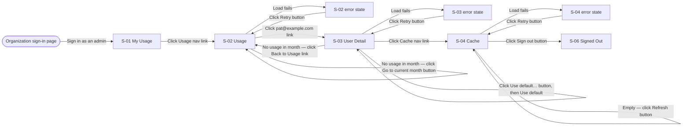
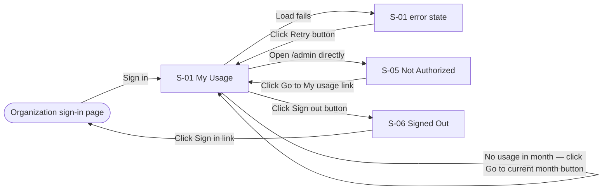

# PeakMedia MCP Servers — Screen Inventory

**Document Version:** 1.0
**Date:** 2026-11-12
**Status:** Draft
**Companion:** `concept-of-operations.md` v1.1 (Section 5 steps cite these IDs)
**Wireframes:** `wireframes/S-NN-<kebab-name>.html` — open in a browser; grayscale on purpose

These screens are the gateway's usage dashboard (Blazor, Interactive Server, Blazor Blueprint UI components). It is the
last scope area to be built, after narration, cache and quotas. Scenarios 1–4, 6 and 7 have no
screens: they run in Claude Code, the gateway and the stdio server.

---

## App Shell

**Site header.** The dashboard has three top-level destinations at most (My usage, Usage, Cache),
so a sidebar is not justified. The shell is the same on every signed-in screen:

- **App header** — brand `PeakMedia Gateway`; primary nav with the current item marked; the signed-in
  email and a `"Sign out"` button on the right. Below 480 px the nav, email and `"Sign out"` collapse
  into a `Sheet` behind a `≡` trigger.
- **Per-role nav** — one shell, different items: a **user** sees `"My usage"` only; an **admin**
  (member of `Admin:Group`) sees `"My usage"`, `"Usage"`, `"Cache"`. Admin items are absent from a
  non-admin's nav, not disabled.
- **Page header** — the `h1` left, primary actions right (the `"Month"` select, `"Refresh"`), a
  subtitle line beneath (month, counts, reset date). Stacks to full-width controls at the 320 px
  layout floor.
- **Content** — stat `Card`s for single-record figures (My Usage, Cache); a `Table` for desk-side
  scanning across columns (Usage, User Detail), reflowing to labelled stacked blocks below 480 px.
- **Footer strip** — the app version (`PeakMediaRemoteMcpServer v<semver>`), as thin chrome.

Signed-out screens: **S-06 Signed Out** uses the auth block (brand-only header over a centered
400 px column). There is no gateway sign-in form — sign-in happens on the organization's Okta page.
No dialog or sheet screens; the one confirmation (`"Use default…"`) is an `AlertDialog` on S-03.

Layout floor: 320 px, per the UX Baseline in `CLAUDE.md`. Wireframe region names (`Card`, `Table`,
`AlertDialog`, `Sheet`, `Toast`, `Breadcrumb`) map onto the Blazor Blueprint UI components of the
same names.

---

## Screen Inventory

| Screen ID | Name | Wireframe | Purpose | Entry points | Primary actions | Data shown | States | Serves |
|-----------|------|-----------|---------|--------------|-----------------|------------|--------|--------|
| S-01 | My Usage | `wireframes/S-01-my-usage.html` | A user sees their own month: spent, quota, remaining, clips, cache hits, reset date. | Sign-in landing (`/`); `"My usage"` nav link | `"Month"` select; `"Go to current month"` button (empty state); `"Retry"` button (error state); `"Sign out"` button (header) | Stat `Card`s: Spent, Quota, Remaining, Clips synthesized, Cache hits, Resets — the same figures `my_usage` returns; an `OVER` notice when spent ≥ quota. US dollars to the cent, dates in UTC | loading / empty / error / populated | S5.1, S5.2, S8.1, S8.2, S8.3 |
| S-02 | Usage | `wireframes/S-02-usage.html` | An admin sees every user's spend for a month and who is over quota. | `"Usage"` nav link (`/admin`) — admins only | `"Month"` select; user email link (e.g. `"pat@example.com"`); `"Go to current month"` button (empty state); `"Retry"` button (error state) | `Table`, one row per user, sorted by Spent (highest first): Email, Spent, Quota, Characters, Clips, Cache-hit rate, Status (`OVER` badge where spent ≥ quota); a `Total` footer row | loading / empty / error / populated | S5.3, S5.4 |
| S-03 | User Detail | `wireframes/S-03-user-detail.html` | An admin sees one user's requests for a month and sets or resets their quota. | S-02 user email link (`/admin/users/{id}`) — admins only | `"Month"` select; `"Monthly quota (USD)"` input; `"Save"` button; `"Use default…"` button (confirmation: `"Cancel"`, `"Use default"`); `"Usage"` breadcrumb link; `"Back to Usage"` link (empty state); `"Retry"` button (error state) | Subtitle: month, spent of quota, `OVER` badge, clips, cache-hit rate. Quota form with the current quota and whether it is the default. `Table`, one row per clip, newest first: Time (UTC), Model, Voice, Characters, Cost, Source (`synthesized` / `cached`) — never the narration text | loading / empty / error / populated | S5.4, S5.5, S5.7 |
| S-04 | Cache | `wireframes/S-04-cache.html` | An admin checks cache size against the cap, hit rate and evictions. | `"Cache"` nav link (`/admin/cache`) — admins only | `"Refresh"` button; `"Retry"` button (error state) | Stat `Card`s: Size, Size cap (`Storage:CacheMaxGb`), Clips, Hit rate this month, Evicted this month | loading / empty / error / populated | S5.8 |
| S-05 | Not Authorized | `wireframes/S-05-not-authorized.html` | A non-admin who opens an admin page learns why and where to go. | A non-admin opens any `/admin` address directly (HTTP 403) | `"Go to My usage"` link | The message `This page is for gateway administrators.` | n/a — not data-bearing | S8.4 |
| S-06 | Signed Out | `wireframes/S-06-signed-out.html` | A person confirms the browser session ended and can sign in again. | `"Sign out"` button in the app header | `"Sign in"` link | The message `You are signed out` | n/a — not data-bearing | S5.9, S8.5 |

---

## States

### S-01 My Usage

- **loading** — the figures card is skeletoned; visible text "Loading your usage…"
- **empty** — "No usage in 2026-11" with "Narration you request through the peak-media tools in Claude Code appears here. Your quota is $25.00 for the month."; offers `"Go to current month" button`
- **error** — "Couldn't load your usage. Check your connection and try again."; offers `"Retry" button`
- **populated** — the six stat cards; when spent ≥ quota, a notice: "You have reached your monthly quota ($25.32 of $25.00). Narration is paused until 2026-12-01 00:00 UTC. Ask an administrator to raise your quota."

### S-02 Usage

- **loading** — the table is skeletoned; visible text "Loading usage for 2026-11…"
- **empty** — "No usage in 2026-11" with "Nobody requested narration in this month."; offers `"Go to current month" button`
- **error** — "Couldn't load usage for 2026-11. Check your connection and try again."; offers `"Retry" button`
- **populated** — the users table sorted by Spent with `OVER` badges and the `Total` footer row; subtitle "2026-11 · 3 users · 1 over quota · sorted by Spent, highest first"

### S-03 User Detail

- **loading** — the requests table is skeletoned; visible text "Loading usage for pat@example.com…"
- **empty** — "No usage for pat@example.com in 2026-11" with "This user requested no narration in this month. You can still change their quota above."; the quota form stays; offers `"Back to Usage" link`
- **error** — "Couldn't load usage for pat@example.com. Check your connection and try again."; offers `"Retry" button`
- **populated** — the quota form and the requests table. Messages: after `"Save"`, "Quota set to $60.00/month (was $25.00, the default). Applies to Pat's next call."; after `"Use default"`, "Quota reset to the default ($25.00/month)."; invalid amount, "Enter an amount of $0.00 or more, for example 60."; failed save, "Couldn't save the quota. Check your connection and press Save again." `"Use default…"` opens the confirmation "Reset pat@example.com to the default quota?" with `"Cancel"` first and default.

### S-04 Cache

- **loading** — the figures card is skeletoned; visible text "Loading cache statistics…"
- **empty** — "The cache is empty" with "Clips appear here after the first narration request."; offers `"Refresh" button`
- **error** — "Couldn't load cache statistics. Check your connection and try again."; offers `"Retry" button`
- **populated** — the five stat cards; subtitle "12.4 GB of 20 GB used (62%) · least-recently-used clips are removed first when full"

### S-05 Not Authorized

- **states** — n/a — not data-bearing; single rendering described in the wireframe

### S-06 Signed Out

- **states** — n/a — not data-bearing; single rendering described in the wireframe

---

## Flows

### Scenario 5: Admin reviews and adjusts usage

**Steps served:** S5.1–S5.5, S5.7–S5.9 (S5.6 has no screen)

### Scenario 8: Checking my usage in the browser

**Steps served:** S8.1–S8.5

